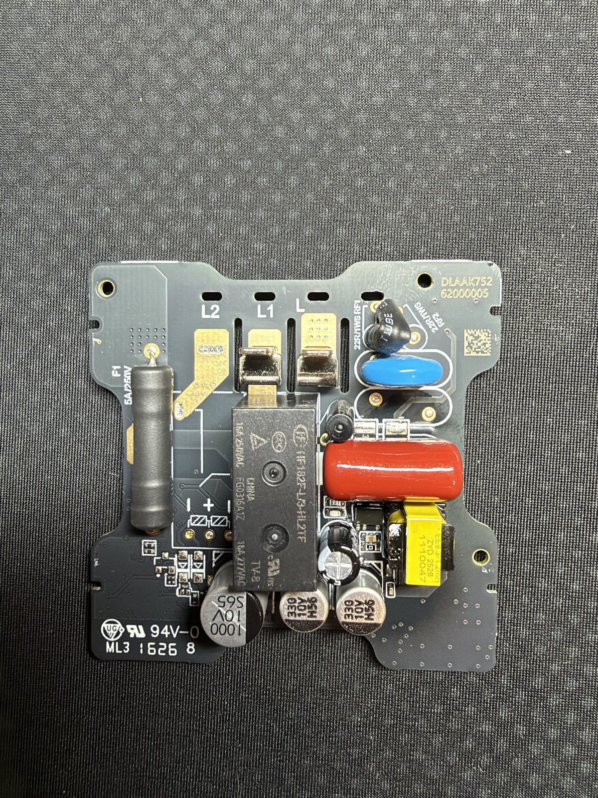
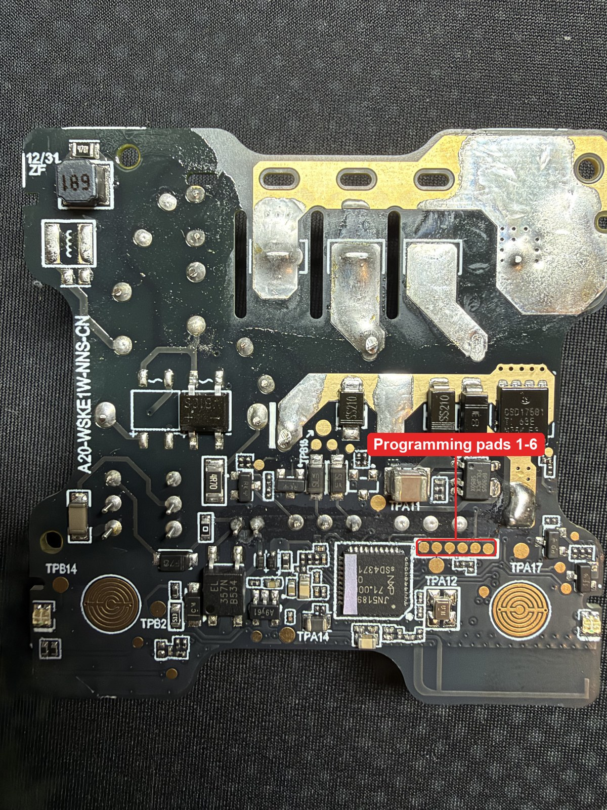
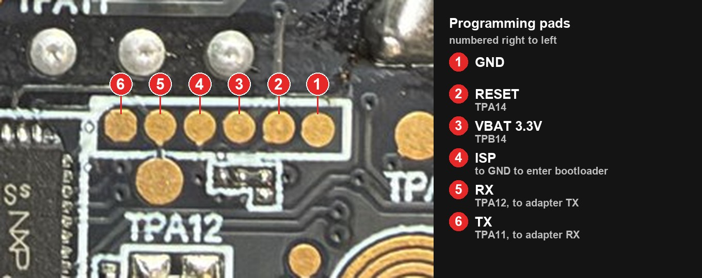

# Overview
[QBKG38LM](https://www.zigbee2mqtt.io/devices/QBKG38LM.html) - Aqara smart wall switch E1, no neutral, single rocker
(module board `A20-WSKE1W-NNS-CN` + power board `DLAAK752`, MCU NXP JN5189).

The firmware makes the switch a mains powered Zigbee end device with the receiver always on (no sleep), so commands
from the coordinator apply at once. The relay is the On/Off server on endpoint 2; endpoint 1 holds Basic and the
configuration cluster (`0xFC00`, manufacturer code `0x1037`).

Zigbee model ID: `lumi.switch.b1lc04.diy`, manufacturer name `DIY` - deliberately different from the stock
`lumi.switch.b1lc04`, so that the built-in Zigbee2MQTT definition of the stock device (and its OTA) never applies.

| Power board `DLAAK752` (relay side) | Module board `A20-WSKE1W-NNS-CN` (JN5189 side) |
|---|---|
|  |  |

User-facing settings, flashing and pairing: [main README](../../README.md).

# Hardware
Measured on this board (chip pin -> PIO). The pin map differs from the [ducktoast](https://www.ducktoast.com/blog/electronics-projects/aqara-e1/aqara-e1-switch-fix/) E1
schematic (neutral, double rocker board).

| Function | Chip pin | PIO | Notes |
|----------|----------|-----|-------|
| Rocker (both pads are one net) | 16 | PIO13 | idle high, pressed = low |
| Blue LED 1 / 2 | 19 / 3 | PIO16 / PIO0 | active low, one LED pair on each side of the rocker |
| Red LED 1 / 2 | 25 / 6 | PIO21 / PIO3 | active low, network status |
| Relay "close" coil driver | 22 | PIO18 | low-side transistor, active high |
| Relay "open" coil driver | 21 | PIO17 | low-side transistor, active high |
| Relay coil supply switch | 24 | PIO20 | active high, see below |
| Debug UART TX / RX | - | PIO8 / PIO9 | USART0, 115200 |

**Relay.** HF182F-L/3-HL2TF: latching, two 3 V coils (11.25 Ω each) with a common "+". Datasheet: operate time
≤ 10 ms, pulse ≥ 50 ms, never energize both coils at once. The firmware pulses one coil at a time for 50 ms.

**Coil supply.** The common "+" of the coils is a separate rail with a 1000 µF capacitor. It is charged through a
two-transistor high-side switch (near TPA17), resistor and diode, enabled by **PIO20 = 1**. Without it the rail stays
at 0 V and the relay never switches on mains, although everything else works. The firmware turns the switch on 0.5 s
after boot and sends the first coil pulse 1 s later, when the rail is charged.

**Power.** No-neutral supply: a flyback converter on the power board (EE8.3 transformer, MB10S bridge on the module
board) and BP8005 with a MOSFET (CSD17581) harvesting power while the relay is closed, see the
[BP8005 datasheet](https://taoic.oss-cn-hangzhou.aliyuncs.com/6466/product/HZ6749_1710154246000.pdf).
The JN5189 is fed by its own LDO (SOT-23-5 marked `A9y61`, output VBAT). The low-voltage ground is the mains live
wire (L).

## Programming pads
Row of 6 pads next to the JN5189, counted right to left:

| # | Pad | Test point |
|---|-----|------------|
| 1 | GND | |
| 2 | RESET | TPA14 |
| 3 | VBAT (3.3 V) | TPB14 |
| 4 | ISP (hold to GND while resetting to enter ISP) | |
| 5 | RX of the chip | TPA12 |
| 6 | TX of the chip | TPA11 |

ISP access is write-only on this device (set by the manufacturer): the flash can only be erased as a whole and
written; it cannot be read.

## Bench power
To run the module on the bench (not on mains), feed 3.3 V to VBAT for the MCU. For the relay, feed 3.3 V directly to
the "+" of the relay coils (the 1000 µF capacitor): which supply the PIO20 switch draws from was not traced, so it may
stay unpowered on the bench. Never apply a voltage across a coil in reverse: the protective diode across the coil
shorts it.

# Build
Preset `QBKG38LM`. See [Building from source](../../README.md#building-from-source).
